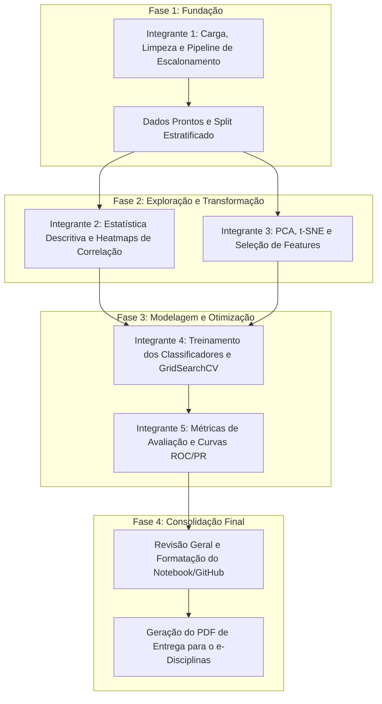

# Planejamento do Projeto Final - SME0828 (ICMC/USP)
**Introdução à Ciência de Dados — Prof. Francisco Rodrigues**  
**Tema:** Diagnóstico e Classificação de Câncer de Mama (*Wisconsin Diagnostic Breast Cancer - WDBC*)

---

> [!WARNING]
> **Atenção quanto ao tamanho do grupo:** As instruções oficiais do professor especificam: *"Grupo: No máximo 3 pessoas (pode ser menos)"*. Como vocês estão em 5 integrantes, certifiquem-se de alinhar com o professor/monitor se há autorização para grupos de 5 ou se haverá necessidade de divisão formal na entrega. A divisão abaixo contempla perfeitamente os 5 integrantes de forma equilibrada.

---

## 1. Visão Geral da Base de Dados Real
- **Arquivos presentes:** `data/raw/wdbc.data` e `data/raw/wdbc.names`
- **Total de instâncias:** 569 pacientes
- **Atributos:** 32 colunas:
  1. `ID` (identificador, deve ser descartado no modelo).
  2. `Diagnosis` (**Target**: `M` = Maligno [212 casos], `B` = Benigno [357 casos]).
  3. Colunas 3 a 32: 30 medições morfométricas celulares computadas a partir de imagens de punção aspirativa por agulha fina (FNA) — *mean*, *standard error* e *worst* de: *radius, texture, perimeter, area, smoothness, compactness, concavity, concave points, symmetry, fractal dimension*.
- **Pergunta Fundamental / Hipótese:**
  > *"É possível classificar tumores de mama com alta precisão e sensibilidade a partir de atributos morfométricos de biópsia aspirativa, minimizando diagnósticos falso-negativos?"*

---

## 2. Divisão de Trabalho entre os 5 Integrantes

| Integrante | Papel Principal | Foco Metodológico | Entregas Principais |
| :--- | :--- | :--- | :--- |
| **Integrante 1** | **Engenharia de Dados e Pipeline Base** | Passos 1 e 5 (Preparação) | Carga correta com cabeçalhos de `wdbc.names`, descarte de ID, codificação do Target (B=0, M=1), pipelines de normalização (`StandardScaler`/`MinMaxScaler`), separação treino/teste estratificada sem vazamento de dados. |
| **Integrante 2** | **Análise Estatística e EDA Visual** | Passos 2 e 3 (Estatística e Padrões) | Estatísticas descritivas (média, mediana, desvio padrão, assimetria, curtose por classe), boxplots comparativos, pairplots das variáveis mais preditivas, mapas de calor (correlação Pearson/Spearman) e identificação de multicolinearidade. |
| **Integrante 3** | **Projeção, Seleção de Features e Agrupamento** | Passos 4 e 7 (Transformação e Agrupamento) | Clustering não-supervisionado (K-Means/GMM para testar separabilidade natural), PCA (Scree plot + projeção 2D/3D), t-SNE, e métodos de Seleção de Atributos (correlação, SelectKBest, RFE). |
| **Integrante 4** | **Modelagem Preditiva e Ajuste de Modelos** | Passos 4 e 5 (Classificação e Tuning) | Treinamento dos modelos (Regressão Logística, KNN, SVM Linear/RBF, Naive Bayes, Random Forest), validação cruzada estratificada (`StratifiedKFold`), e busca de hiperparâmetros (`GridSearchCV`). |
| **Integrante 5** | **Avaliação Clínica, Síntese e Documentação** | Passos 6, 8, 9 e 10 (Métricas, Discussão e Sumário) | Comparação com múltiplas métricas (Acurácia, Recall/Sensibilidade, Especificidade, F1, Curva ROC-AUC, Matriz de Confusão), análise médica do Falso Negativo, redação da discussão, sumário executivo e compilação do Notebook/PDF final. |

---

## 3. Cronograma Integrado em 4 Fases

---

## 4. Estrutura do Notebook Jupyter Final (`notebooks/analise_cancer_mama.ipynb`)
1. **Introdução e Formulação da Pergunta Científica**
2. **Carga e Preparação dos Dados (Limpeza, Encodings, Verificação)**
3. **Estatística Descritiva dos Dados**
4. **Análise Exploratória e Visualização de Padrões (EDA)**
5. **Estudo de Agrupamento Não-Supervisionado (K-Means e PCA/t-SNE)**
6. **Seleção de Atributos e Engenharia de Features**
7. **Treinamento e Ajuste Fino dos Modelos Supervisionados**
8. **Avaliação Comparativa de Desempenho (Métricas, ROC, Matrizes de Confusão)**
9. **Discussão dos Resultados, Implicações Médicas e Limitações**
10. **Sumário Executivo e Conclusões**
